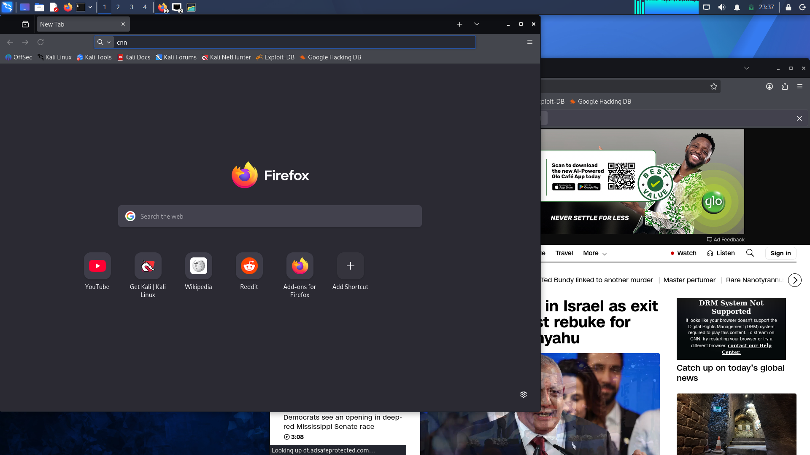

# Kali Linux Virtual Machine Setup

## Overview

I successfully installed and configured Kali Linux in Oracle VirtualBox. This project gave me practical experience setting up a virtual machine, allocating hardware resources, configuring network settings, and resolving installation and integration issues. I also added an Android operating system to my lab environment.

## Configuration and Setup

I adjusted the virtual machine’s CPU, memory, and storage to suit the operating system. I configured the network connection and confirmed that Kali Linux could access the internet.

The network settings shown below use a manually assigned IPv4 address of `10.0.0.2`, a `/24` network prefix, gateway `10.0.0.1`, and DNS server `8.8.8.8`.

## Challenges and Solutions

I encountered difficulties with VirtualBox shared folders and clipboard sharing. I also had trouble installing GRUB during the Kali Linux installation. I used online tutorials to troubleshoot the GRUB issue and complete the installation.

GRUB is a bootloader that helps start an operating system; it is not a partition type. After resolving the installation issue, I continued configuring the virtual machine and confirmed that it could connect to the internet.

## Learning Outcomes

This project improved my practical understanding of:

- Allocating CPU, RAM, and storage to a virtual machine
- Installing and configuring Kali Linux in VirtualBox
- Troubleshooting bootloader and installation issues
- Configuring IPv4 networking, a gateway, and DNS
- Testing internet connectivity in a virtual machine
- Adding an Android operating system to a lab environment

## Conclusion

The setup was completed successfully. Kali Linux was installed, the network was configured, and internet access was confirmed. Troubleshooting GRUB, shared folders, and clipboard sharing gave me valuable hands-on experience with virtual machine configuration.

## Screenshots

